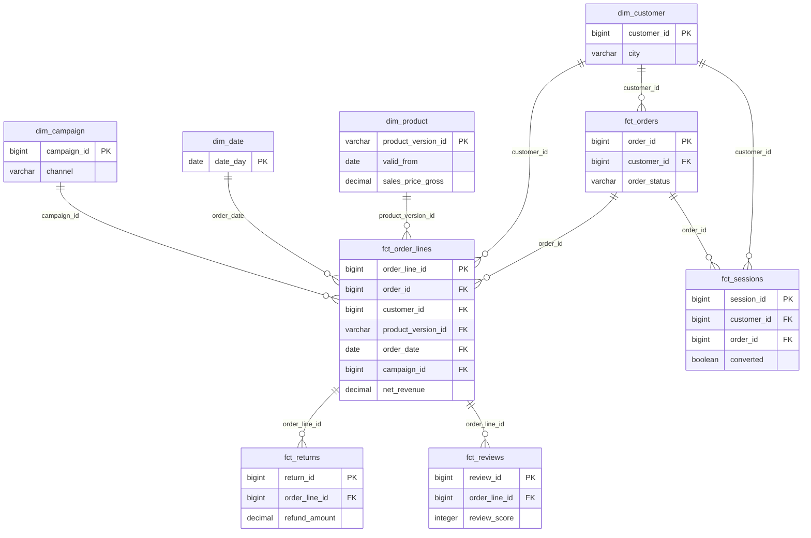

# Shop Data Warehouse

[](https://github.com/tlabedzki/Shop-Data-Warehouse/actions/workflows/tests.yml)


Studium przypadku hurtowni danych sklepu internetowego: od dziennych plików CSV przez DuckDB, dbt i Airflow do
schematu gwiazdy z testami danych sprawdzonymi kluczem odpowiedzi.

**Problem.** Systemy sklepu codziennie zrzucają pliki z klientami, produktami, zamówieniami i ruchem na stronie.
W plikach są braki, literówki, zdublowane wiersze i liczby wpisane w złych jednostkach. Raport policzony wprost
z plików wygląda wiarygodnie, a nikt nie wie, ile w nim błędów ani czy czyszczenie czegoś nie psuje.

**Podejście.** Hurtownia ładuje każdy dzień raz i w całości, dbt czyści dane i składa z nich schemat gwiazdy
z testami. Generator danych zna każdy błąd, który wstrzyknął, więc kod sprawdza, ile hurtownia złapała, naprawiła
i przeoczyła.

<!-- generated:result -->
**Wynik.** Z 13 451 wstrzykniętych błędów hurtownia znajduje wszystkie: 8 958 naprawia do prawdziwej wartości, a 4 493
zostawia jako nieznane, bo prawdy nie ma w danych. Nie podnosi ani jednego fałszywego alarmu. Raport liczony wprost
z plików zawyżyłby przychód netto o 70%.
<!-- /generated:result -->

<!-- generated:hero -->
<picture>
  <source media="(prefers-color-scheme: dark)" srcset="docs/img/app-demo-dark.svg">
  
</picture>
<!-- /generated:hero -->

**Stack:** Python · DuckDB · dbt · Airflow · pandas · Dash · Plotly · pytest

<!-- generated:summary -->
- **Trafione:** status 55 568 zamówień złożony z 219 278 zdarzeń, cena wersji produktu w dniu zamówienia i scalenie
  1 200 drugich kont zgadzają się z generatorem w 100%.
- **Chybione:** 17 z 241 niemożliwych ilości i 576 z 1 205 braków operatora płatności zostają nieznane, bo w danych nie
  ma skąd ich odtworzyć.
<!-- /generated:summary -->

## 1. Sklep, jego pliki i pytania

Lumo to fikcyjny polski sklep internetowy z [Data Generatora](https://github.com/tlabedzki/Data-Generator):
40 tysięcy klientów, 50 tysięcy produktów i zamówienia z lat 2023–2024. Jego systemy codziennie zostawiają folder
z dziesięcioma plikami CSV (zwykłymi tabelami tekstowymi) i manifestem, czyli spisem plików z liczbą wierszy
i odciskiem treści. Hurtownia (jedna baza, w której te pliki stają się uporządkowanymi tabelami do raportów) ma
odpowiedzieć na pytania właściciela tak, żeby każdą odpowiedź dało się sprawdzić:

| Pytanie | Jak odpowiada hurtownia | Gdzie leży prawdziwa odpowiedź |
|---|---|---|
| Czy każdy dzień wszedł raz i w całości? | Kontrola manifestu i ładowanie dnia w jednej transakcji (rozdział 3) | Manifest dnia |
| Ile błędów jest w danych i które da się naprawić? | Reguły czyszczenia w dbt i dziennik `quality.dq_issues` (rozdział 4) | `quality_issue_data` z generatora |
| Jaki status ma zamówienie? | Ostatnie zdarzenie z dziennika zamówienia (rozdział 5) | `order_status` w generatorze |
| Ile kosztował produkt w dniu zamówienia? | Historia wersji produktu (rozdział 5) | `price_history` w generatorze |
| Ilu klientów ma sklep? | Scalanie drugich kont tej samej osoby (rozdział 4) | Klienci w generatorze |
| Ile sklep naprawdę zarobił? | Tabele raportowe dbt (rozdział 6) | Ten sam sklep bez błędów |
| Czy codzienne uruchomienia dają to samo co pełne ładowanie? | Airflow dzień po dniu kontra jedno ładowanie (rozdział 7) | Pełne ładowanie tych samych dni |

## 2. Skąd wiadomo, co jest prawdą

Data Generator v1.7.1 tworzy sklep dwa razy z tym samym ziarnem losowania (seed 42, czyli ten sam punkt startu
losowania, więc ten sam sklep). Raz wstrzykuje błędy jakości na poziomie „medium” (ok. 3% wierszy na rodzaj błędu),
raz nie wstrzykuje żadnych. Błędy mają własny strumień losowania, więc poza nimi oba sklepy są identyczne.

Klucz odpowiedzi to:

- `quality_issue_data`: każdy wstrzyknięty błąd z tabelą, kluczem wiersza, kolumną, wartością w pliku
  i prawdziwą wartością;
- tabele generatora: status zamówienia, status płatności, spóźnienie dostawy, historia cen i lista klientów.

Hurtownia klucza nie widzi. Do plików dziennych nie trafia żadna kolumna prawdy, dbt czyta tylko pliki, a z kluczem
porównuje dopiero `score.py` po zbudowaniu hurtowni. Każdy wstrzyknięty błąd dostaje jedną ocenę:

- **naprawiony**: hurtownia go znalazła i trzyma prawdziwą wartość;
- **złapany**: znalazła, ale prawdziwej wartości nie ma w danych (np. brak telefonu), więc zostawia ją pustą;
- **źle naprawiony**: znalazła, ale wpisała inną wartość niż prawdziwa;
- **przeoczony**: nie znalazła.

Wykrycie bez błędu w kluczu to fałszywy alarm. Kontrola to sklep bez błędów: hurtownia nie powinna tam zgłosić nic.

## 3. Pliki dzienne: czy każdy dzień wchodzi raz i w całości?

**Pytanie.** Czy hurtownia ma dokładnie to, co systemy sklepu wysłały, także gdy dzień przyjdzie później albo
zostanie uruchomiony drugi raz?

**Co robi hurtownia.** Plik dnia niesie tylko to, co system wiedział tego dnia: zamówienie przychodzi bez statusu,
a status dochodzi później jako zdarzenia (opłacone, wysłane, dostarczone, zwrócone). Ładowanie sprawdza każdy plik
z manifestem (liczba wierszy i SHA-256, czyli odcisk treści, który zmienia się przy każdej zmianie pliku) oraz
nagłówek kolumn. Potem usuwa dzień i wstawia go od nowa w jednej transakcji, więc ponowne ładowanie daje te same
tabele (ładowanie idempotentne). Wszystko trafia do schematu `raw` jako tekst, z datą wyciągu i nazwą pliku.

**Jak to sprawdzamy.** Test dbt porównuje dziennik ładowań z liczbą wierszy w `raw`. Testy pytest psują plik
(dopisany wiersz, zmieniona kolumna, brak manifestu) i sprawdzają, że ładowanie staje bez zmian w hurtowni.

**Wynik.**

<!-- generated:loads -->
Hurtownia przyjęła 776 dni po 10 plików (7 760 plików, 219 278 zdarzeń zamówień). Najwięcej linii zamówień, 867,
przyszło 29 lis 2024, w tygodniu Black Friday.


<!-- /generated:loads -->

**Co to znaczy dla sklepu.** Spóźniony albo powtórzony dzień nie dubluje sprzedaży, a uszkodzony plik zatrzymuje
ładowanie, zanim cokolwiek zmieni w raportach.

## 4. Czyszczenie: ile błędów łapią reguły i testy?

**Pytanie.** Ile błędów jest w danych klientów, produktów i zamówień, które da się naprawić i co zostaje nieznane?

**Co robi hurtownia.** Warstwa staging w dbt (pierwsza warstwa modeli: typy, czyszczenie, każdy rekord raz)
stosuje reguły zapisane w SQL. Telefon w dowolnym zapisie staje się `+48` i dziewięcioma cyframi, miasto pochodzi
z kodu pocztowego, a niemożliwy wiek staje się nieznany. Dwa konta z tym samym numerem konta bankowego to jedna osoba.
Cena zakupu ponad pięć razy wyższa od ceny netto to cena wpisana w groszach. Ilość ponad 20 sztuk na linii hurtownia
odtwarza z kwoty płatności (kwota = linie po rabacie + dostawa). Każde wykrycie trafia do dziennika
`quality.dq_issues`, a każda reguła ma test dbt z poziomem ostrzeżenia, więc `dbt build` pokazuje, ile znalazła.

**Jak to sprawdzamy.** `score.py` łączy dziennik z kluczem po tabeli, kluczu wiersza i kolumnie i ocenia każdy błąd
(rozdział 2). Wartości porównuje w jednym zapisie (np. `720 731 397` i `+48720731397` to ten sam numer).

**Wynik.**

<!-- generated:quality -->
dbt build na sklepie z błędami: 90 testów zielonych i 15 ostrzeżeń, po jednym na regułę jakości; 5 testów jednostkowych
reguł przechodzi. Klucz odpowiedzi: 8 958 błędów naprawionych, 4 493 złapanych bez możliwej naprawy, 0 przeoczonych albo
źle naprawionych, 0 fałszywych alarmów. Jeszcze 220 wykryć to kopie błędu oryginału na drugich kontach (generator
kopiuje konto razem z jego błędami).


<!-- /generated:quality -->

**Co to znaczy dla sklepu.** Hurtownia mówi wprost, czego nie wie: brakującego telefonu czy koloru nie zgaduje,
tylko zostawia pustą wartość i liczy takie przypadki.

## 5. Schemat gwiazdy: czy hurtownia sama składa fakty jak generator?

**Pytanie.** Czy fakty, których nie ma w żadnym pliku wprost (aktualny status zamówienia, cena w dniu zamówienia,
liczba klientów), wychodzą takie jak w generatorze?

**Co robi hurtownia.** Warstwa core to schemat gwiazdy: tabele faktów (linie zamówień, zamówienia, sesje, zwroty,
opinie) w środku i tabele wymiarów (klient, produkt, data, kampania) dookoła. Status zamówienia to ostatnie
zdarzenie z jego dziennika. Produkt ma historię wersji (SCD2, czyli wymiar wolno zmienny typu 2: nowy wiersz przy
każdej zmianie ceny, z datami od i do), liczoną z historii wyciągów zamiast z migawek dbt. Dzięki temu ładowanie
wstecz daje tę samą historię. Modele core mają kontrakty: dbt sprawdza nazwy i typy kolumn przed zapisem.

**Jak to sprawdzamy.** `score.py` porównuje każdy złożony fakt z tabelą generatora.

**Wynik.**

<!-- generated:core -->
| Fakt złożony przez hurtownię | Sprawdzone | Zgodne |
|---|---:|---:|
| Status zamówienia z dziennika zdarzeń = status w generatorze | 55 568 | 55 568 |
| Status płatności = status w generatorze | 55 568 | 55 568 |
| Spóźniona dostawa = znacznik generatora | 52 452 | 52 452 |
| Cena wersji produktu w dniu zamówienia = cena na linii | 80 326 | 80 326 |
| Klienci po scaleniu drugich kont = osoby w generatorze | 40 000 | 40 000 |
<!-- /generated:core -->

**Co to znaczy dla sklepu.** Raport o zamówieniach, cenach i klientach liczony z hurtowni zgadza się z tym, co
działo się naprawdę, choć żaden plik nie podaje tych liczb wprost.

## 6. Raport z surowych plików kontra hurtownia

**Pytanie.** Ile myli się raport, który ktoś policzy wprost z plików, bez hurtowni?

**Co robi hurtownia.** Tabele raportowe (marts: sprzedaż dzienna, ruch na stronie, kohorty, czyli klienci
pogrupowani po miesiącu pierwszego zakupu) liczą przychód netto i marżę brutto z linii po czyszczeniu. Dla
porównania te same linie liczymy wprost z plików: z kopiami, z wpisanymi ilościami i z cenami w groszach.

**Jak to sprawdzamy.** Prawdą jest ten sam sklep bez błędów: hurtownia na danych z błędami powinna dać prawie te same
sumy co na czystych.

**Wynik.**

<!-- generated:gap -->
Przychód netto w hurtowni: 35,7 mln zł, w raporcie z surowych plików 60,8 mln zł (+70%). Marża brutto: 12,7 mln zł
kontra 8,9 mln zł (−30%). Klientów 40 000, a kont w plikach 41 200.


<!-- /generated:gap -->

**Co to znaczy dla sklepu.** Zdublowane linie i ilości wpisane z zerem za dużo wystarczą, żeby raport z plików
pokazał sprzedaż, której nie było, i marżę, która w niektórych miesiącach spada poniżej zera.

## 7. Airflow: czy dzień po dniu wychodzi to samo?

**Pytanie.** Czy hurtownia budowana codziennie, jak na produkcji, kończy z tymi samymi tabelami co jedno pełne
ładowanie?

**Co robi hurtownia.** DAG Airflow (opis kolejnych zadań, które Airflow uruchamia codziennie) czeka na manifest
dnia, ładuje dzień i uruchamia `dbt build` tylko dla tego dnia. Modele faktów są przyrostowe: przeliczają tylko
zamówienia, które tego dnia dostały linię, zdarzenie, płatność, wysyłkę albo zwrot. Airflow i dbt potrzebują różnych
wersji pakietów, więc Airflow ma własne środowisko i wywołuje kroki projektu przez jego linię poleceń.

**Jak to sprawdzamy.** `main.py --daily` buduje pierwsze dni dzień po dniu i porównuje skróty wszystkich tabel
z pełnym ładowaniem. W CI prawdziwy Airflow 3.4 uruchamia DAG dla pięciu dni małego sklepu, powtarza jeden z nich
i porównuje wynik z pełnym ładowaniem.

**Wynik.**

<!-- generated:daily -->
Pierwsze 14 dni ładowane dzień po dniu dają 13 tabel warstw core, marts i quality równych bajt w bajt pełnemu ładowaniu
tych samych dni (zgodne).
<!-- /generated:daily -->

**Co to znaczy dla sklepu.** Codzienne ładowanie, ponowne uruchomienie dnia i odbudowa historii od zera dają te same
raporty.

## 8. Hurtownia kontra prawda

<!-- generated:verdicts -->
| Pytanie | Odpowiedź hurtowni | Prawda | Ocena |
|---|---|---|---|
| Błędy, których prawda jest w danych (rodzaje: 8): czy wraca prawdziwa wartość? | naprawione 8 105 | 8 105 w kluczu | trafione |
| Braki i niemożliwe wartości (rodzaje: 5): czy hurtownia je łapie bez zgadywania? | nieznane 3 900 | 3 900 w kluczu | trafione, prawdy nie ma w danych |
| Brak operatora płatności: czy da się naprawić? | naprawione 629, nieznane 576 | 1 205 w kluczu | częściowo |
| Ilość od 50 do 500 sztuk: czy da się naprawić? | naprawione 224, nieznane 17 | 241 w kluczu | częściowo |
| Status, płatność, spóźnienie, cena, klienci: czy zgadzają się z generatorem? | jak w rozdziale 5 | tabele generatora | trafione |

Kontrola: ten sam sklep bez błędów daje 0 wykryć, a 105 z 105 testów dbt przechodzi bez ostrzeżeń. Fałszywe alarmy na
sklepie z błędami: 0. Pełna lista rodzajów błędów: [docs/quality-issues.md](docs/quality-issues.md).
<!-- /generated:verdicts -->

**Gdzie reguły się pomyliły i czego to uczy.** W końcowym wyniku nie ma pomyłek, ale po drodze klucz odpowiedzi
złapał cztery:

- Reguła „cena zakupu nie wyższa od ceny netto” na pierwszych dniach oznaczała prawdziwe ceny jako błąd, bo część
  produktów startowała z ceną katalogową poniżej kosztu. Lekcja: próg z danych (w czystym sklepie stosunek ceny
  zakupu do ceny netto nie przekracza dwóch, a w groszach wynosi co najmniej kilkadziesiąt), a nie z założenia.
- Test relacji „sesja → zamówienie” był czerwony w trybie dziennym: sesja sprzed północy kończy się zamówieniem
  zapisanym w pliku następnego dnia. Lekcja: dane przychodzą spóźnione i test musi to znać.
- Generator przy kopii konta bez e-maila zapisał tekst `None`. Reguła formatu najpierw zostawiła go jako adres
  `none`. Lekcja: adres bez `@` to brak adresu.
- Części ilości nie da się odtworzyć: zamówienie bez wysyłki nie ma znanej opłaty za dostawę. Lekcja: hurtownia
  mówi „nie wiem”, zamiast zgadywać.

Pomyłki pokazane wprost są atutem: ocenę wystawia kod na podstawie klucza, więc może powiedzieć „przeoczone”.
Dlatego „trafione” w tabeli coś znaczy.

## 9. Wnioski i ograniczenia

**Rekomendacje.**

1. Nie licz raportów wprost z plików: kopie i błędne jednostki zawyżają sprzedaż i psują marżę.
2. Każdą regułę czyszczenia trzymaj w jednym miejscu (dbt) z dziennikiem wykryć i testem, który go liczy.
3. Wartości, których nie ma w danych, zostawiaj puste i licz je, zamiast zgadywać.
4. Ładuj dzień w całości albo wcale i sprawdzaj, że dzień po dniu daje to samo co pełne ładowanie.

**Ograniczenia.**

- Dane są syntetyczne: błędy mają znane rodzaje i proporcje. W prawdziwym sklepie pojawią się inne, a próg ceny
  zakupu trzeba by wyznaczyć z jego danych.
- Jedno ziarno losowania i jeden poziom błędów („medium”).
- Bez klucza odpowiedzi kontrolą zostaje dziennik wykryć, testy dbt i uzgodnienia sum między warstwami.
- Airflow działa tylko w CI na Linuksie; na Windowsie te same kroki uruchamia `main.py`.

## Szybki start

Potrzebujesz Gita i Pythona 3.11. Sklonuj repozytorium:

```bash
git clone https://github.com/tlabedzki/Shop-Data-Warehouse.git
cd Shop-Data-Warehouse
```

<details><summary>Utwórz i włącz środowisko wirtualne z Pythonem 3.11 (Windows, macOS i Linux)</summary>

Podanie wersji wybiera Pythona 3.11, nawet jeśli domyślny jest inny.

| Krok | Windows (PowerShell) | macOS i Linux |
|---|---|---|
| Utwórz | `py -3.11 -m venv .venv` | `python3.11 -m venv .venv` |
| Włącz | `.venv\Scripts\Activate.ps1` | `source .venv/bin/activate` |
| Sprawdź | `python --version` pokazuje `Python 3.11.x` | `python --version` pokazuje `Python 3.11.x` |

Jeśli PowerShell mówi, że uruchamianie skryptów jest wyłączone, uruchom raz
`Set-ExecutionPolicy -Scope CurrentUser RemoteSigned` i włącz środowisko jeszcze raz.

</details>

Potem zainstaluj pakiety i zbuduj hurtownię:

```bash
pip install -r requirements.txt
python main.py --daily
```

Pierwsze uruchomienie pobiera Data Generator z GitHuba, generuje oba sklepy, zapisuje pliki dzienne, buduje dwie
hurtownie i wpisuje wynik do `output/results.json` (ok. 7 minut; kolejne bez generowania ok. 2 minut).

### Aplikacja

`python -m ui.app` otwiera pod adresem http://127.0.0.1:8050 cztery sekcje: ładowania, błędy kontra klucz, raport
z plików kontra hurtownia i dowody. Ctrl+C zatrzymuje serwer.

### dbt i Airflow

Model dbt jest w `dbt/`; `dbt docs generate` i `dbt docs serve` z `--project-dir dbt --profiles-dir dbt` pokazują
dokumentację i graf zależności. DAG leży w `airflow/dags/`, a jego uruchomienie opisuje job `airflow` w
[tests.yml](.github/workflows/tests.yml).

## Dane

Dane są syntetyczne: [Data Generator](https://github.com/tlabedzki/Data-Generator) v1.7.1, seed 42, lata
2023–2024, poziom błędów „medium” i „none”. Kod generatora jest pobierany i uruchamiany bez zmian
(`src/shop_warehouse/source.py`). Słownik kodów pocztowych z miastami (`dbt/seeds/postal_codes.csv`) pochodzi
z tego samego pliku generatora. Źródło: ZnajdzKod.pl na podstawie PRG (GUGiK) i TERYT (GUS), stan 16.09.2026
(atrybucja po polsku, jak wymaga źródło). Nazwy marek produktów są prawdziwe, a same produkty fikcyjne.

Schemat gwiazdy (klucze i 1–2 pola na tabelę; pełny diagram w [docs/erd.md](docs/erd.md), zależności modeli
w [docs/lineage.md](docs/lineage.md)):

<!-- generated:erd -->

<!-- /generated:erd -->

## Struktura projektu

<details><summary>Pokaż drzewo</summary>

```
main.py                     cały przebieg: generowanie, pliki, ładowanie, dbt, ocena (--daily: dzień po dniu)
src/shop_warehouse/
  source.py                 Data Generator: klon wydania i dwa sklepy
  landing.py                pliki dzienne CSV z manifestem
  load.py                   ładowanie dnia do schematu raw w DuckDB
  pipeline.py               kroki wspólne dla main.py i Airflow; dbt build
  cli.py                    linia poleceń wywoływana przez DAG
  score.py                  ocena względem klucza odpowiedzi (jedyne miejsce, które czyta prawdę)
  report.py, figures.py     liczby, tytuły i wykresy dla aplikacji i README
dbt/                        staging → intermediate → core → marts, quality; testy, kontrakty, słownik kodów
airflow/dags/               dzienny DAG; airflow/tests: test jego struktury
ui/                         aplikacja Dash + Mantine
scripts/                    wykresy i liczby README, animacja, ERD z manifestu dbt
tests/                      pytest
```

</details>

## Testy

```bash
pip install -r requirements-dev.txt
python -m pytest
```

32 testy pytest (ok. 50 s) sprawdzają pliki dzienne, ładowanie i jego odporność na zepsute pliki, ocenę względem
klucza, aplikację oraz zbudowanie małego sklepu przez dbt w pełnym i dziennym trybie. Do tego 105 testów danych
dbt i 5 testów jednostkowych reguł czyszczenia w każdym `dbt build`, a w CI test DAG-a w prawdziwym Airflow.

## Licencja

MIT, zobacz [LICENSE](LICENSE). [Changelog](CHANGELOG.md).

Ostatnia aktualizacja README: 2026-11-27
