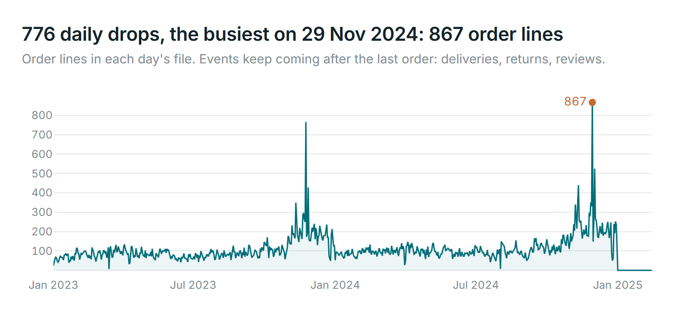
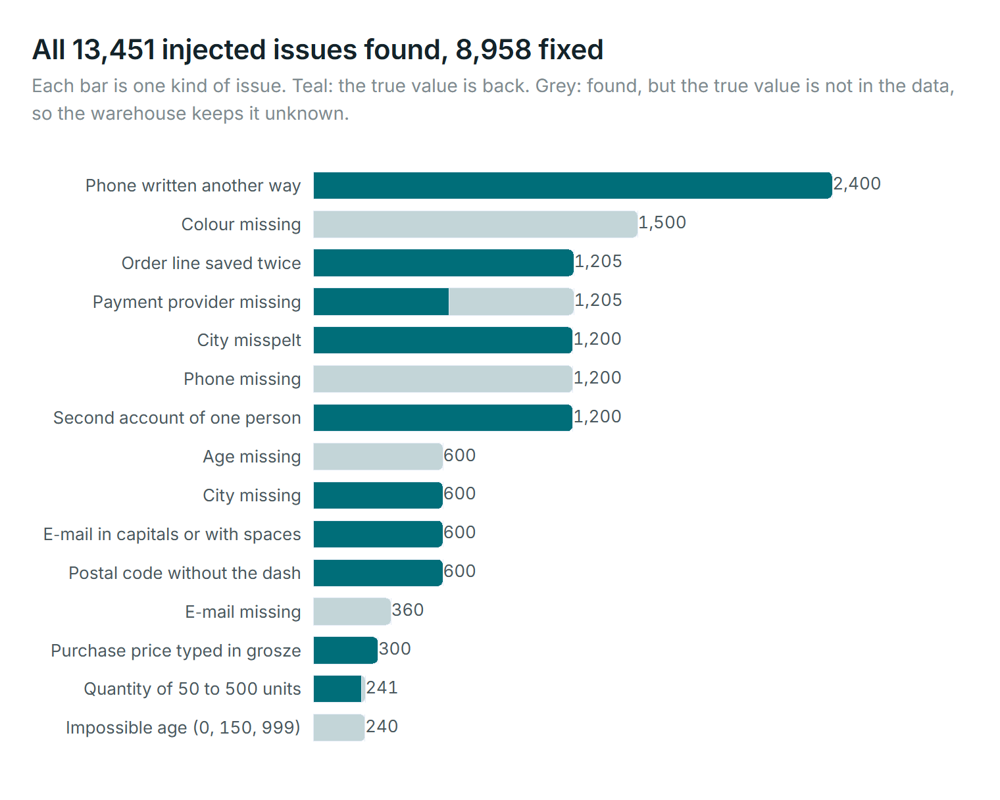
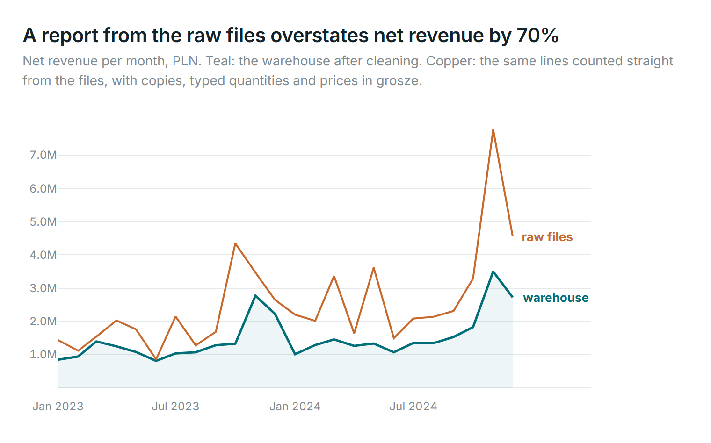
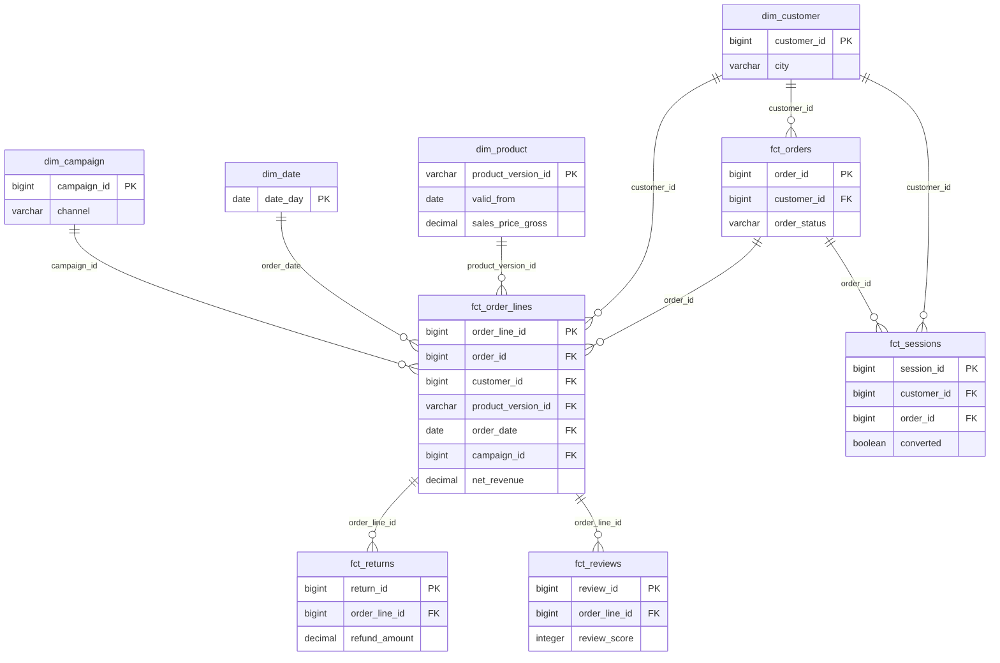

# Shop Data Warehouse

[](https://github.com/tlabedzki/Shop-Data-Warehouse/actions/workflows/tests.yml)


[](https://github.com/tlabedzki/Shop-Data-Warehouse/releases)

A case study of an online shop's data warehouse: daily CSV files through DuckDB, dbt and Airflow to a star schema
whose data tests are checked against an answer key.

**Problem.** The shop's systems drop files every day with customers, products, orders and website traffic. The files
have gaps, typos, duplicated rows and numbers typed in the wrong units. A report counted straight from the files
looks believable, and nobody knows how many errors it carries or whether cleaning breaks something.

**Approach.** The warehouse loads each day once and in full, and dbt cleans the data and builds a star schema with
tests. The data generator knows every issue it injected, so code checks how many the warehouse caught, fixed and
missed.

<!-- generated:result -->
**Result.** Of 13,451 injected issues the warehouse finds every one: it fixes 8,958 to the true value, keeps 4,493
unknown because the truth is not in the data, and raises no false alarm. A report counted straight from the files would
overstate net revenue by 70%.
<!-- /generated:result -->

<!-- generated:hero -->
<picture>
  <source media="(prefers-color-scheme: dark)" srcset="docs/img/app-demo-dark.svg">
  
</picture>
<!-- /generated:hero -->

**Stack:** Python · DuckDB · dbt · Airflow · pandas · Dash · Plotly · pytest

<!-- generated:summary -->
- **What worked:** the status of 55,568 orders built from 219,278 events, the product version's price on the order day
  and the merge of 1,200 second accounts agree with the generator 100%.
- **What missed:** 17 of 241 impossible quantities and 576 of 1,205 missing payment providers stay unknown: nothing in
  the data tells the true value.
<!-- /generated:summary -->

## 1. The shop, its files and its questions

Lumo is a fictional Polish online shop from [Data Generator](https://github.com/tlabedzki/Data-Generator):
40,000 customers, 50,000 products and orders from 2023–2024. Every day its systems leave a folder with ten CSV files
(plain text tables) and a manifest, a list of the files with their row counts and a fingerprint of their content.
The warehouse (one database where these files become tidy tables for reports) has to answer the owner's questions in
a way that every answer can be checked:

| Question | How the warehouse answers | Answer to check against |
|---|---|---|
| Did every day load once and in full? | Manifest check and loading a day in one transaction (chapter 3) | The day's manifest |
| How many errors are in the data, and which can be fixed? | Cleaning rules in dbt and the log `quality.dq_issues` (chapter 4) | `quality_issue_data` from the generator |
| What is an order's status? | The latest event in the order's log (chapter 5) | `order_status` in the generator |
| What did a product cost on the order day? | The product's version history (chapter 5) | `price_history` in the generator |
| How many customers does the shop have? | Merging second accounts of one person (chapter 4) | Customers in the generator |
| How much did the shop really earn? | dbt reporting tables (chapter 6) | The same shop without issues |
| Do daily runs give the same as a full load? | Airflow day by day against one load (chapter 7) | A full load of the same days |

## 2. How we know the truth

Data Generator v1.7.1 builds the shop twice with the same random seed (seed 42: the same starting point of the random
draws, so the same shop). Once it injects data quality issues at the "medium" level (about 3% of rows per kind of
issue), once it injects none. The issues come from their own random stream, so apart from them both shops are
identical.

The answer key is:

- `quality_issue_data`: every injected issue with its table, row key, column, the value in the file and the true
  value;
- the generator's tables: order status, payment status, late delivery, price history and the list of customers.

The warehouse never sees the key. No truth column lands in the daily files, dbt reads only the files, and only
`score.py` compares with the key after the warehouse is built. Every injected issue gets one verdict:

- **fixed**: the warehouse found it and holds the true value;
- **caught**: it found it, but the true value is not in the data (a missing phone number), so it keeps it empty;
- **fixed wrongly**: it found it but wrote another value than the true one;
- **missed**: it did not find it.

A detection without an issue in the key is a false alarm. The control is the shop without issues: there the warehouse
should report nothing.

## 3. Daily files: does every day load once and in full?

**Question.** Does the warehouse hold exactly what the shop's systems sent, also when a day arrives late or runs a
second time?

**What we did.** A day's file carries only what the system knew that day: an order arrives without its status, and
the status follows later as events (paid, shipped, delivered, returned). Loading checks every file against the
manifest (row count and SHA-256, a fingerprint that changes with any change to the file) and the column header.
Then it deletes the day and inserts it again in one transaction (the write goes in whole or not at all), so loading
again gives the same tables (idempotent loading). Everything lands in the `raw` schema as text, with the extract
date and the file name.

**How we check it.** A dbt test compares the load log with the row counts in `raw`. pytest tests break a file (an
extra row, a renamed column, a missing manifest) and check that loading stops and changes nothing in the warehouse.

**Result.**

<!-- generated:loads -->
The warehouse took 776 days of 10 files (7,760 files, 219,278 order events). The busiest file, 29 Nov 2024, brought 867
order lines in the Black Friday week.


<!-- /generated:loads -->

**What it means for the shop.** A late or repeated day does not double the sales, and a broken file stops the load
before it changes anything in the reports.

## 4. Cleaning: how many issues do the rules and tests catch?

**Question.** How many errors are in the customer, product and order data? Which can be fixed, and what stays
unknown?

**What we did.** The staging layer in dbt (the first layer of models: types, cleaning, each record once) applies
rules written in SQL. A phone number in any notation becomes `+48` and nine digits, the city comes from the postal
code, and an impossible age becomes unknown. Two accounts with the same bank account number are one person. A
purchase price over five times the net list price is a price typed in grosze (hundredths of a złoty). The warehouse
recovers a quantity over 20 units on a line from the payment amount (amount = lines after discount + delivery). Every
detection goes to the log `quality.dq_issues`, and every rule has a dbt test with warning severity, so `dbt build`
shows how many it found.

**How we check it.** `score.py` joins the log with the key on table, row key and column and grades every issue
(chapter 2). It compares values in one notation (for example `720 731 397` and `+48720731397` are the same number).

**Result.**

<!-- generated:quality -->
dbt build on the shop with issues: 90 tests pass and 15 warn, one per quality rule; 5 unit tests of the rules pass.
Against the answer key: 8,958 issues fixed, 4,493 found without a possible fix, 0 missed or fixed wrongly, 0 false
alarms. Another 220 detections are copies of the original's issue on second accounts (the generator copies an account
with its issues).


<!-- /generated:quality -->

**What it means for the shop.** The warehouse says plainly what it does not know: a missing phone number or colour
stays empty, and the warehouse counts such cases.

## 5. Star schema: does the warehouse build facts the way the generator does?

**Question.** Do the facts that no file gives directly (an order's current status, the price on the order day, the
number of customers) come out as in the generator?

**What we did.** The core layer is a star schema: fact tables (order lines, orders, sessions, returns, reviews) in the
middle and dimension tables (customer, product, date, campaign) around them. An order's status is the latest event in
its log. A product has a version history (SCD2, a type 2 slowly changing dimension: a new row on every price change,
with from and to dates), built from the history of extracts instead of dbt snapshots, so a backfill gives the same
history. The core models have contracts: dbt checks column names and types before writing.

**How we check it.** `score.py` compares every assembled fact with the generator's own table.

**Result.**

<!-- generated:core -->
| Fact the warehouse built | Checked | Agree |
|---|---:|---:|
| Order status from the event log = status in the generator | 55,568 | 55,568 |
| Payment status = status in the generator | 55,568 | 55,568 |
| Late delivery = generator's flag | 52,452 | 52,452 |
| List price of the line's product version = generator's price that day | 80,326 | 80,326 |
| Account mapped to its person (second accounts from the answer key) | 41,200 | 41,200 |
<!-- /generated:core -->

**What it means for the shop.** A report on orders, prices and customers from the warehouse matches what really
happened, although no file states these numbers directly.

## 6. A report from the raw files against the warehouse

**Question.** How far off is a report that someone counts straight from the files, without a warehouse?

**What we did.** The reporting tables (marts: daily sales, website traffic and cohorts, which are customers grouped
by the month of their first purchase) compute net revenue and gross margin from the cleaned lines. For comparison we
count the same lines straight from the files: with copies, typed quantities and prices in grosze.

**How we check it.** The truth is the same shop without issues: the warehouse on data with issues should give almost
the same totals as on clean data.

**Result.**

<!-- generated:gap -->
Net revenue in the warehouse: 35.7M PLN, in a report from the raw files 60.8M PLN (+70%). Gross margin: 12.7M PLN
against 8.9M PLN (−30%). 40,000 customers, while the files hold 41,200 accounts.


<!-- /generated:gap -->

**What it means for the shop.** Duplicated lines, impossible quantities and purchase prices in grosze are enough for
a report from the files to show sales that never happened and a margin that drops below zero in some months.

## 7. Airflow: does day by day give the same?

**Question.** Does a warehouse built every day, as in production, end with the same tables as one full load?

**What we did.** The Airflow DAG (the list of tasks Airflow runs every day) waits for the day's manifest, loads the
day and runs `dbt build` for that day only. The fact models are incremental: they recompute only the orders that got
a line, an event, a payment, a shipment or a return that day. Airflow and dbt need different package versions, so
Airflow has its own environment and calls the project's steps through its command line.

**How we check it.** `main.py --daily` builds the first days one by one and compares hashes of every table with a
full load. In CI (automated tests on GitHub after every push) a real Airflow 3.4 runs the DAG for five days of a small
shop, repeats one of them and compares the result with a full load.

**Result.**

<!-- generated:daily -->
The first 14 days loaded one by one give 13 tables of the core, marts and quality layers equal byte for byte to a full
load of the same days (equal).
<!-- /generated:daily -->

**What it means for the shop.** The daily load, a rerun of a day and rebuilding the history from scratch give the
same reports.

## 8. Warehouse against the truth

<!-- generated:verdicts -->
| Question | Warehouse answer | Truth | Verdict |
|---|---|---|---|
| Issues whose truth is in the data (8 kinds): does the true value come back? | fixed 8,105 | 8,105 in the key | hit |
| Missing and impossible values (5 kinds): are they caught without guessing? | unknown 3,900 | 3,900 in the key | hit, no truth in the data |
| Payment provider missing: can it be fixed? | fixed 629, unknown 576 | 1,205 in the key | partial |
| Quantity of 50 to 500 units: can it be fixed? | fixed 224, unknown 17 | 241 in the key | partial |
| Status, payment, lateness, price, customers: do they agree with the generator? | as in chapter 5 | generator tables | hit |

Control: the same shop without issues gives 0 detections, and 105 of 105 dbt tests pass without a warning. False alarms
on the shop with issues: 0. Every kind of issue: [docs/quality-issues.md](docs/quality-issues.md).
<!-- /generated:verdicts -->

**Where the rules went wrong and what it teaches.** The final result has no misses, but along the way the answer key
caught three. The fourth point is the limit of what can be recovered:

- The rule "purchase price not above the net list price" flagged real prices as errors on the first days, because
  some products started with a list price below cost. Lesson: take the threshold from the data (in the clean shop
  the purchase price stays below twice the net price, while a price in grosze is many times higher).
- The relationship test "session → order" failed in daily mode: a session before midnight ends with an order written
  to the next day's file. Lesson: data arrives late, and the test has to allow for it.
- The generator wrote the text `None` for a copied account without an e-mail. The format rule first kept it as the
  address `none`. Lesson: an address without `@` is no address.
- Some quantities cannot be recovered: an order that never shipped has no known delivery fee. Lesson: when the data
  cannot tell, the warehouse says "I don't know".

Showing the misses openly is what makes the grading credible: code checks the warehouse against the key and can say
"missed", so a "hit" in the table carries weight.

## 9. Takeaways and limitations

**Recommendations.**

1. Do not count reports straight from the files: copies and wrong units inflate sales and spoil the margin.
2. Keep every cleaning rule in one place (dbt) with a log of detections and a test that counts them.
3. Keep values that are not in the data empty and count them instead of guessing.
4. Load a day in full or not at all, and check that day by day gives the same as a full load.

**Limitations.**

- The data is synthetic: the issues have known kinds and shares. A real shop will have others, and the purchase
  price threshold would have to come from its data.
- One random seed and one issue level ("medium").
- Without an answer key the checks left are the detection log, the dbt tests and totals reconciled between layers.
- Only the fact tables are incremental; dbt rebuilds the intermediate layer, the dimensions and the reporting tables
  every day. At this scale that takes seconds, but with years of history the intermediate layer would have to be
  incremental too.
- Airflow runs only in CI on Linux; on Windows `main.py` runs the same steps.

## Quickstart

You need Git and Python 3.11. Clone the repository:

```bash
git clone https://github.com/tlabedzki/Shop-Data-Warehouse.git
cd Shop-Data-Warehouse
```

<details><summary>Create and activate a virtual environment with Python 3.11 (Windows, macOS and Linux)</summary>

Naming the version picks Python 3.11 even if another one is the default.

| Step | Windows (PowerShell) | macOS and Linux |
|---|---|---|
| Create | `py -3.11 -m venv .venv` | `python3.11 -m venv .venv` |
| Activate | `.venv\Scripts\Activate.ps1` | `source .venv/bin/activate` |
| Check | `python --version` prints `Python 3.11.x` | `python --version` prints `Python 3.11.x` |

If PowerShell says that running scripts is disabled, run `Set-ExecutionPolicy -Scope CurrentUser RemoteSigned` once
and activate again.

</details>

Then install the packages and build the warehouse:

```bash
pip install -r requirements.txt
python main.py --daily
```

The first run downloads Data Generator from GitHub, generates both shops, writes the daily files, builds two
warehouses and writes the result to `output/results.json` (about 4 minutes; later runs without generating about 2).

### App

`python -m ui.app` opens four sections at http://127.0.0.1:8050: loads, issues against the key, raw files against
the warehouse, and proofs. Ctrl+C stops the server.

### dbt and Airflow

The dbt project is in `dbt/`; `dbt docs generate` and `dbt docs serve` with `--project-dir dbt --profiles-dir dbt`
show the documentation and the dependency graph. The DAG is in `airflow/dags/`, and the `airflow` job in
[tests.yml](.github/workflows/tests.yml) shows how to run it.

## Data

The data is synthetic: [Data Generator](https://github.com/tlabedzki/Data-Generator) v1.7.1, seed 42, years
2023–2024, issue levels "medium" and "none". The generator's code is downloaded and run unchanged
(`src/shop_warehouse/source.py`). The list of postal codes with their cities (`dbt/seeds/postal_codes.csv`) comes
from the same generator file. Source: ZnajdzKod.pl na podstawie PRG (GUGiK) i TERYT (GUS), stan 16.09.2026
(attribution in Polish, as required by the source). Product brand names are real; the products are fictional.

The star schema (keys and 1–2 fields per table; the full diagram is in [docs/erd.md](docs/erd.md), the model
dependencies in [docs/lineage.md](docs/lineage.md)):

<!-- generated:erd -->

<!-- /generated:erd -->

## Why these tools

Each tool was picked for how this project reads its data: every daily file is read once, in full, when it is loaded,
and the warehouse is read by aggregating queries from dbt, the app and the charts. A fresh clone has to rebuild
everything with one command, with no server, account, key or paid service.

| Tool | What it does here and why it fits | Alternative considered |
|---|---|---|
| Data Generator | Generates the fictional shop with injected quality issues and a table listing every one of them, which is the answer key the grading needs; the same seed without issues gives the clean shop as a control. | The public Olist Brazilian E-Commerce data has real errors, but its license is non-commercial, it has no answer key and it is a different shop from the rest of the portfolio. |
| Daily CSV files | Untyped text, the way shop systems export data, so format and type errors survive until staging and the tests have to catch them. | Daily Parquet files are typed and several times smaller, but some errors (a malformed date, text in a numeric column) would disappear while writing them. |
| DuckDB | The warehouse in one file: column storage makes aggregations fast, it reads CSV directly and it runs with dbt on Windows and in CI without a server. | PostgreSQL stores rows (slower to aggregate) and needs Docker or an installed service; BigQuery and Snowflake need an account, keys and payment. |
| dbt Core | Keeps the cleaning rules, the star schema and the reporting tables as SQL models with data tests, contracts and unit tests, and its manifest draws the ERD and the lineage. | dbt v2 had no mature DuckDB adapter when the project was built; dbt snapshots for product history depend on when they run and would not rebuild the same history day by day, so a model does it; generic tests are written in the project instead of packages from dbt Hub, so the tests need no network. |
| Airflow | The daily DAG with backfill, a thin layer over the same command line steps that `main.py` runs; it runs in CI on Linux in its own environment, because its dependencies conflict with dbt Core. | Running Airflow locally with docker-compose was left out: Airflow does not run on Windows and that setup could not be tested on the machine the project was built on. |
| pandas and pyarrow | Turn the generated tables into daily files and grade the warehouse against the answer key; pyarrow lets the generator save its tables as Parquet, and both use the same versions as Data Generator, so its unchanged code runs in this project's environment. | – |
| Dash and Mantine | The app, built from the same blocks as every app in this portfolio, with numbers from the same functions as the README. | Streamlit and Gradio were ruled out for all apps in the portfolio: they sit side by side on the GitHub profile and a different look stands out. |
| pytest | Tests the daily files, loading, grading, the app and a small shop built through dbt, locally and in CI. | – |

## Project structure

<details><summary>Show the tree</summary>

```
main.py                     the whole run: generate, land, load, dbt, grade (--daily: day by day)
src/shop_warehouse/
  source.py                 Data Generator: clone a release, two shops
  landing.py                daily CSV files with a manifest
  load.py                   load a day into the raw schema in DuckDB
  pipeline.py               steps shared by main.py and Airflow; dbt build
  cli.py                    command line the DAG calls
  score.py                  grading against the answer key (the only place that reads the truth)
  report.py, figures.py     numbers, titles and charts for the app and the README
dbt/                        staging → intermediate → core → marts, quality; tests, contracts, postal codes
airflow/dags/               daily DAG; airflow/tests: a test of its structure
ui/                         Dash + Mantine app
scripts/                    README charts and numbers, the animation, the ERD from the dbt manifest
tests/                      pytest
```

</details>

## Tests

```bash
pip install -r requirements-dev.txt
python -m pytest
```

26 pytest tests (about 45 s) check the daily files, loading and how it handles broken files, grading against the key,
the app, and building a small shop through dbt in full and daily mode. On top of that, every `dbt build` runs 105 dbt
data tests and 5 unit tests of the cleaning rules, and CI tests the DAG in a real Airflow.

## License

MIT, see [LICENSE](LICENSE). [Changelog](CHANGELOG.md).

README last updated: 2026-11-27
