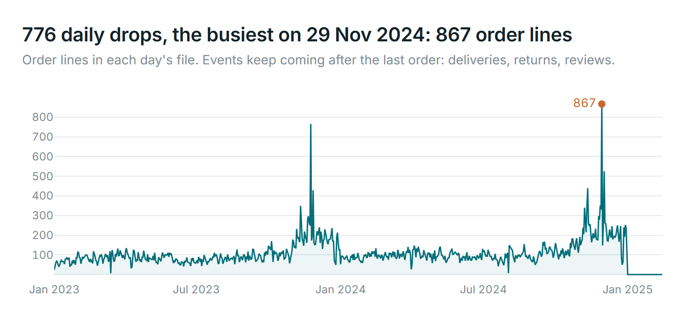
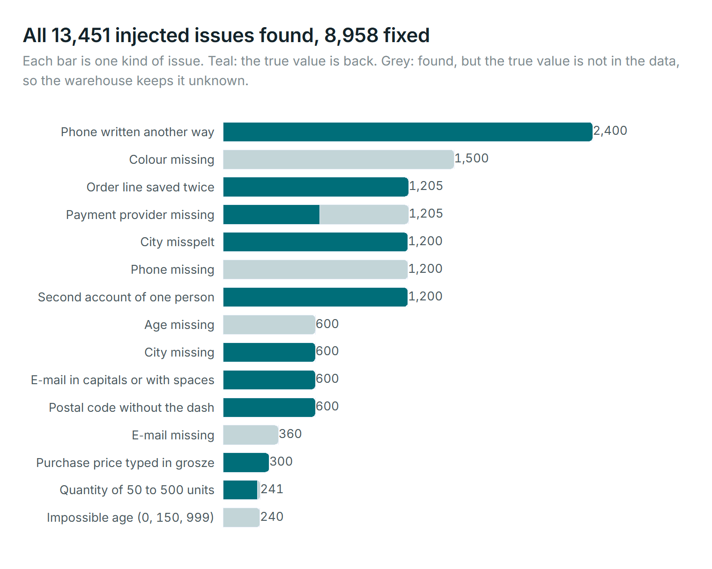
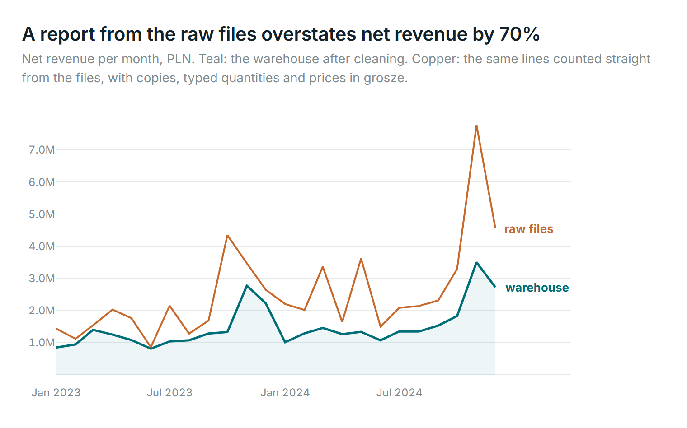
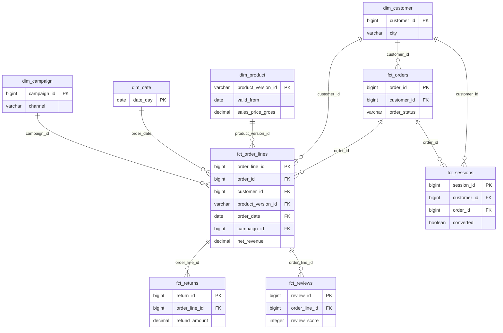

# Shop Data Warehouse

[English](README.md) | **Polski**

[](https://github.com/tlabedzki/Shop-Data-Warehouse/actions/workflows/tests.yml)


[](https://github.com/tlabedzki/Shop-Data-Warehouse/releases)

Studium przypadku: hurtownia danych sklepu internetowego. Codzienne pliki CSV przechodzą przez DuckDB, dbt i Airflow
do schematu gwiazdy (star schema: tabele faktów w środku, tabele opisów wokół nich). Wyniki testów danych
porównujemy z kluczem odpowiedzi (answer key), czyli z listą błędów celowo wstawionych do danych.

**Problem.** Systemy sklepu codziennie zostawiają pliki z klientami, produktami, zamówieniami i ruchem w serwisie.
W plikach są luki, literówki, zdublowane wiersze i liczby wpisane w złych jednostkach. Raport policzony wprost
z plików wygląda wiarygodnie. Nikt jednak nie wie, ile zawiera błędów ani czy czyszczenie danych czegoś nie psuje.

**Podejście.** Hurtownia ładuje każdy dzień raz i w całości, a dbt czyści dane i buduje z nich schemat gwiazdy
z testami. Generator danych zna każdy błąd, który celowo wstawił (wstrzyknął), więc kod sprawdza, ile z nich
hurtownia złapała, naprawiła i przeoczyła.

<!-- generated:result -->
**Wynik.** Z 13 451 wstrzykniętych błędów hurtownia znajduje wszystkie: 8 958 naprawia do prawdziwej wartości, a 4 493
zostawia jako nieznane, bo prawdy nie ma w danych. Nie podnosi ani jednego fałszywego alarmu. Raport liczony wprost
z plików zawyżyłby przychód netto o 70%.
<!-- /generated:result -->

<!-- generated:hero -->
<picture>
  <source media="(prefers-color-scheme: dark)" srcset="docs/img/app-demo-dark.svg">
  
</picture>
<!-- /generated:hero -->

**Stack:** Python · DuckDB · dbt · Airflow · pandas · Dash · Plotly · pytest

<!-- generated:summary -->
- **Trafione:** status 55 568 zamówień złożony z 219 278 zdarzeń, cena wersji produktu w dniu zamówienia i scalenie
  1 200 drugich kont zgadzają się z generatorem w 100%.
- **Chybione:** 17 z 241 niemożliwych ilości i 576 z 1 205 braków operatora płatności zostają nieznane, bo w danych nie
  ma skąd ich odtworzyć.
<!-- /generated:summary -->

## 1. Sklep, jego pliki i pytania właściciela

Lumo to fikcyjny polski sklep internetowy z [Data Generatora](https://github.com/tlabedzki/Data-Generator):
40 000 klientów, 50 000 produktów i zamówienia z lat 2023–2024. Każdego dnia jego systemy zostawiają folder
z dziesięcioma plikami CSV (zwykłymi tabelami w tekście) i manifestem, czyli listą plików z liczbą wierszy
i odciskiem treści każdego z nich. Hurtownia (jedna baza danych, w której te pliki stają się uporządkowanymi tabelami
do raportów) ma odpowiadać na pytania właściciela tak, żeby każdą odpowiedź dało się sprawdzić:

| Pytanie | Jak odpowiada hurtownia | Gdzie leży prawdziwa odpowiedź |
|---|---|---|
| Czy każdy dzień załadował się raz i w całości? | Sprawdzenie manifestu i ładowanie dnia w jednej transakcji (rozdział 3) | Manifest danego dnia |
| Ile błędów jest w danych i które da się naprawić? | Reguły czyszczenia w dbt i dziennik `quality.dq_issues` (rozdział 4) | `quality_issue_data` z generatora |
| Jaki status ma zamówienie? | Ostatnie zdarzenie w dzienniku zamówienia (rozdział 5) | `order_status` w generatorze |
| Ile kosztował produkt w dniu zamówienia? | Historia wersji produktu (rozdział 5) | `price_history` w generatorze |
| Ilu klientów ma sklep? | Scalenie drugich kont tej samej osoby (rozdział 4) | Klienci w generatorze |
| Ile sklep naprawdę zarobił? | Tabele raportowe w dbt (rozdział 6) | Ten sam sklep bez błędów |
| Czy ładowanie dzień po dniu daje to samo co pełne ładowanie? | Airflow dzień po dniu kontra jedno ładowanie (rozdział 7) | Pełne ładowanie tych samych dni |

## 2. Skąd wiadomo, co jest prawdą

Data Generator v1.7.1 buduje sklep dwa razy z tym samym ziarnem losowania (seed 42: ten sam punkt startowy losowań,
więc ten sam sklep). Raz wstrzykuje błędy jakości danych na poziomie „medium” (około 3% wierszy na każdy rodzaj
błędu), a raz nie wstrzykuje żadnych. Błędy pochodzą z osobnego strumienia losowań, więc poza nimi oba sklepy są
identyczne.

Klucz odpowiedzi tworzą:

- `quality_issue_data`: każdy wstrzyknięty błąd z tabelą, kluczem wiersza, kolumną, wartością w pliku i prawdziwą
  wartością;
- tabele generatora: status zamówienia, status płatności, spóźniona dostawa, historia cen i lista klientów.

Hurtownia nigdy nie widzi klucza. Żadna kolumna z prawdą nie trafia do plików dziennych, dbt czyta wyłącznie pliki,
a dopiero `score.py` porównuje wynik z kluczem, gdy hurtownia jest już zbudowana. Każdy wstrzyknięty błąd dostaje
jedną ocenę:

- **naprawiony** (fixed): hurtownia go znalazła i ma prawdziwą wartość;
- **złapany** (caught): znalazła go, ale prawdziwej wartości nie ma w danych (brakujący numer telefonu), więc zostawia
  pole puste;
- **źle naprawiony** (fixed wrongly): znalazła go, ale wpisała inną wartość niż prawdziwa;
- **przeoczony** (missed): nie znalazła go.

Wykrycie, któremu nie odpowiada żaden błąd w kluczu, to fałszywy alarm. Kontrolą jest sklep bez błędów: tam
hurtownia nie powinna zgłosić niczego.

## 3. Pliki dzienne: czy każdy dzień ładuje się raz i w całości?

**Pytanie.** Czy hurtownia ma dokładnie to, co wysłały systemy sklepu, także wtedy, gdy dzień przychodzi
z opóźnieniem albo jest ładowany drugi raz?

**Co robi hurtownia.** Plik danego dnia zawiera tylko to, co system wiedział tego dnia: zamówienie przychodzi bez
statusu, a status dochodzi później jako zdarzenia (opłacone, wysłane, doręczone, zwrócone). Ładowanie porównuje
każdy plik z manifestem (liczba wierszy i SHA-256, czyli odcisk, który zmienia się przy każdej zmianie pliku) oraz
sprawdza nagłówek kolumn. Potem usuwa dany dzień i wstawia go od nowa w jednej transakcji (zapis wchodzi w całości
albo wcale), więc ponowne ładowanie daje te same tabele (ładowanie idempotentne, idempotent loading). Wszystko trafia
do schematu `raw` jako tekst, z datą wyciągu i nazwą pliku.

**Jak to sprawdzamy.** Test dbt porównuje dziennik ładowań z liczbą wierszy w `raw`. Testy pytest psują plik
(dodatkowy wiersz, zmieniona nazwa kolumny, brak manifestu) i sprawdzają, że ładowanie się zatrzymuje i niczego
w hurtowni nie zmienia.

**Wynik.**

<!-- generated:loads -->
Hurtownia przyjęła 776 dni po 10 plików (7 760 plików, 219 278 zdarzeń zamówień). Najwięcej linii zamówień, 867,
przyszło 29 lis 2024, w tygodniu Black Friday.


<!-- /generated:loads -->

**Co to znaczy dla sklepu.** Spóźniony albo powtórzony dzień nie podwaja sprzedaży, a uszkodzony plik zatrzymuje
ładowanie, zanim cokolwiek zmieni się w raportach.

## 4. Czyszczenie: ile błędów łapią reguły i testy?

**Pytanie.** Ile błędów jest w danych klientów, produktów i zamówień? Które da się naprawić, a co zostaje nieznane?

**Co robi hurtownia.** Warstwa staging w dbt (pierwsza warstwa modeli: typy, czyszczenie, każdy rekord raz) stosuje
reguły zapisane w SQL. Numer telefonu w dowolnym zapisie zamienia się na `+48` i dziewięć cyfr, miasto wynika z kodu
pocztowego, a niemożliwy wiek staje się nieznany. Dwa konta z tym samym numerem rachunku bankowego należą do jednej
osoby. Cena zakupu ponad pięć razy wyższa od katalogowej ceny netto to cena wpisana w groszach zamiast w złotych.
Ilość powyżej 20 sztuk w linii zamówienia hurtownia odtwarza z kwoty płatności (kwota = linie po rabacie + dostawa).
Każde wykrycie trafia do dziennika `quality.dq_issues`, a każda reguła ma test dbt, który przy niepowodzeniu zgłasza
ostrzeżenie (warning severity), a nie błąd, więc `dbt build` pokazuje, ile błędów znalazła.

**Jak to sprawdzamy.** `score.py` łączy dziennik z kluczem po tabeli, kluczu wiersza i kolumnie, po czym ocenia każdy
błąd (rozdział 2). Wartości porównuje w jednym zapisie (na przykład `720 731 397` i `+48720731397` to ten sam numer).

**Wynik.**

<!-- generated:quality -->
dbt build na sklepie z błędami: 90 testów zielonych i 15 ostrzeżeń, po jednym na regułę jakości; 5 testów jednostkowych
reguł przechodzi. Klucz odpowiedzi: 8 958 błędów naprawionych, 4 493 złapanych bez możliwej naprawy, 0 przeoczonych albo
źle naprawionych, 0 fałszywych alarmów. Jeszcze 220 wykryć to kopie błędu oryginału na drugich kontach (generator
kopiuje konto razem z jego błędami).


<!-- /generated:quality -->

**Co to znaczy dla sklepu.** Hurtownia mówi wprost, czego nie wie: brakujący numer telefonu czy kolor zostaje pusty,
a hurtownia liczy takie przypadki.

## 5. Schemat gwiazdy: czy hurtownia składa fakty tak jak generator?

**Pytanie.** Czy fakty, których żaden plik nie podaje wprost (bieżący status zamówienia, cena w dniu zamówienia,
liczba klientów), wychodzą takie same jak w generatorze?

**Co robi hurtownia.** Warstwa core to schemat gwiazdy: tabele faktów (linie zamówień, zamówienia, sesje, zwroty,
opinie) w środku i tabele wymiarów (klient, produkt, data, kampania) wokół nich. Status zamówienia to ostatnie
zdarzenie w jego dzienniku. Produkt ma historię wersji (SCD2, slowly changing dimension typu 2, czyli wolno zmieniający
się wymiar: nowy wiersz przy każdej zmianie ceny, z datą od i do). Ta historia powstaje z kolejnych wyciągów zamiast
z migawek dbt (dbt snapshots), więc odbudowa historii od nowa (backfill) daje tę samą historię. Modele core mają
kontrakty: dbt sprawdza nazwy i typy kolumn przed zapisem.

**Jak to sprawdzamy.** `score.py` porównuje każdy złożony fakt z tabelą samego generatora.

**Wynik.**

<!-- generated:core -->
| Fakt złożony przez hurtownię | Sprawdzone | Zgodne |
|---|---:|---:|
| Status zamówienia z dziennika zdarzeń = status w generatorze | 55 568 | 55 568 |
| Status płatności = status w generatorze | 55 568 | 55 568 |
| Spóźniona dostawa = znacznik generatora | 52 452 | 52 452 |
| Cena wersji produktu z linii = cena w historii generatora tego dnia | 80 326 | 80 326 |
| Konto przypisane do właściwej osoby (drugie konta według klucza) | 41 200 | 41 200 |
<!-- /generated:core -->

**Co to znaczy dla sklepu.** Raport o zamówieniach, cenach i klientach z hurtowni zgadza się z tym, co naprawdę się
wydarzyło, choć żaden plik nie podaje tych liczb wprost.

## 6. Raport z surowych plików kontra hurtownia

**Pytanie.** Jak bardzo myli się raport, który ktoś liczy wprost z plików, bez hurtowni?

**Co robi hurtownia.** Tabele raportowe (marts: sprzedaż dzienna, ruch w serwisie i kohorty, czyli klienci
pogrupowani według miesiąca pierwszego zakupu) liczą przychód netto i marżę brutto z wyczyszczonych linii. Dla
porównania liczymy te same linie wprost z plików: z kopiami, błędnie wpisanymi ilościami i cenami w groszach.

**Jak to sprawdzamy.** Prawdą jest ten sam sklep bez błędów: hurtownia na danych z błędami powinna dać prawie te same
sumy co na czystych danych.

**Wynik.**

<!-- generated:gap -->
Przychód netto w hurtowni: 35,7 mln zł, w raporcie z surowych plików 60,8 mln zł (+70%). Marża brutto: 12,7 mln zł
kontra 8,9 mln zł (−30%). Klientów 40 000, a kont w plikach 41 200.


<!-- /generated:gap -->

**Co to znaczy dla sklepu.** Wystarczą zdublowane linie, niemożliwe ilości i ceny zakupu w groszach, żeby raport
z plików pokazał sprzedaż, której nie było, oraz marżę spadającą w niektórych miesiącach poniżej zera.

## 7. Airflow: czy dzień po dniu daje to samo?

**Pytanie.** Czy hurtownia budowana codziennie, jak na produkcji, daje na końcu te same tabele co jedno pełne
ładowanie?

**Co robi hurtownia.** DAG w Airflow (lista zadań, które Airflow uruchamia codziennie) czeka na manifest dnia, ładuje
dzień i uruchamia `dbt build` tylko dla tego dnia. Modele faktów są przyrostowe (incremental): przeliczają tylko te
zamówienia, które tego dnia dostały linię, zdarzenie, płatność, wysyłkę albo zwrot. Airflow i dbt wymagają różnych
wersji pakietów, więc Airflow ma własne środowisko i wywołuje kroki projektu przez jego wiersz poleceń.

**Jak to sprawdzamy.** `main.py --daily` buduje pierwsze dni po kolei i porównuje skróty (hashe) każdej tabeli
z pełnym ładowaniem. W CI (automatycznych testach na GitHubie po każdym pushu) prawdziwy Airflow 3.4 uruchamia DAG
dla pięciu dni małego sklepu, powtarza jeden z nich i porównuje wynik z pełnym ładowaniem.

**Wynik.**

<!-- generated:daily -->
Pierwsze 14 dni załadowano dzień po dniu i porównano z pełnym ładowaniem tych samych dni: 13 tabel warstw core, marts
i quality jest identycznych bajt w bajt (zgodne).
<!-- /generated:daily -->

**Co to znaczy dla sklepu.** Codzienne ładowanie, ponowne uruchomienie dnia i odbudowa historii od zera dają te same
raporty.

## 8. Hurtownia kontra prawda

<!-- generated:verdicts -->
| Pytanie | Odpowiedź hurtowni | Prawda | Ocena |
|---|---|---|---|
| Błędy, których prawda jest w danych (rodzaje: 8): czy wraca prawdziwa wartość? | naprawione 8 105 | 8 105 w kluczu | trafione |
| Braki i niemożliwe wartości (rodzaje: 5): czy hurtownia je łapie bez zgadywania? | nieznane 3 900 | 3 900 w kluczu | trafione, prawdy nie ma w danych |
| Brak operatora płatności: czy da się naprawić? | naprawione 629, nieznane 576 | 1 205 w kluczu | częściowo |
| Ilość od 50 do 500 sztuk: czy da się naprawić? | naprawione 224, nieznane 17 | 241 w kluczu | częściowo |
| Status, płatność, spóźnienie, cena, klienci: czy zgadzają się z generatorem? | jak w rozdziale 5 | tabele generatora | trafione |

Kontrola: ten sam sklep bez błędów daje 0 wykryć, a 105 z 105 testów dbt przechodzi bez ostrzeżeń. Fałszywe alarmy na
sklepie z błędami: 0. Pełna lista rodzajów błędów: [docs/quality-issues.md](docs/quality-issues.md).
<!-- /generated:verdicts -->

**Gdzie reguły się pomyliły i czego to uczy.** Końcowy wynik nie ma przeoczeń, ale po drodze klucz odpowiedzi
wyłapał trzy pomyłki. Czwarty punkt pokazuje granicę tego, co da się odtworzyć:

- Reguła „cena zakupu nie wyższa od katalogowej ceny netto” w pierwszych dniach oznaczała prawdziwe ceny jako błędy,
  bo niektóre produkty startowały z ceną katalogową niższą od kosztu. Lekcja: próg trzeba wziąć z danych (w czystym
  sklepie cena zakupu nie dochodzi do dwukrotności ceny netto, a cena w groszach jest wielokrotnie wyższa).
- Test relacji „sesja → zamówienie” nie przechodził w trybie dziennym: sesja sprzed północy kończy się zamówieniem
  zapisanym w pliku następnego dnia. Lekcja: dane przychodzą z opóźnieniem i test musi to uwzględniać.
- Generator zapisywał tekst `None` dla skopiowanego konta bez e-maila. Reguła formatu początkowo zostawiała go jako
  adres `none`. Lekcja: adres bez `@` nie jest adresem.
- Niektórych ilości nie da się odtworzyć: zamówienie, którego nigdy nie wysłano, nie ma znanej opłaty za dostawę.
  Lekcja: gdy dane nie dają odpowiedzi, hurtownia mówi „nie wiem”.

Ocena jest wiarygodna właśnie dlatego, że otwarcie pokazuje przeoczenia: kod porównuje hurtownię z kluczem i potrafi
powiedzieć „przeoczone”, więc „trafione” w tabeli ma swoją wagę.

## 9. Wnioski dla sklepu i ograniczenia

**Rekomendacje.**

1. Nie licz raportów wprost z plików: kopie i złe jednostki zawyżają sprzedaż i psują marżę.
2. Trzymaj każdą regułę czyszczenia w jednym miejscu (dbt), z dziennikiem wykryć i testem, który je liczy.
3. Wartości, których nie ma w danych, zostawiaj puste i licz je zamiast zgadywać.
4. Ładuj dzień w całości albo wcale i sprawdzaj, czy dzień po dniu daje to samo co pełne ładowanie.

**Ograniczenia.**

- Dane są syntetyczne: błędy mają znane rodzaje i udziały. Prawdziwy sklep będzie miał inne, a próg ceny zakupu
  trzeba by wziąć z jego danych.
- Jedno ziarno losowania i jeden poziom błędów („medium”).
- Bez klucza odpowiedzi zostają dziennik wykryć, testy dbt i sumy uzgadniane między warstwami.
- Przyrostowe są tylko tabele faktów; warstwę pośrednią (intermediate), wymiary i tabele raportowe dbt przebudowuje
  codziennie. Przy tej skali trwa to kilka sekund, ale przy latach historii warstwa pośrednia też musiałaby być
  przyrostowa.
- Airflow działa tylko w CI na Linuksie; na Windowsie te same kroki uruchamia `main.py`.

## Szybki start

Potrzebujesz Gita i Pythona 3.11. Sklonuj repozytorium:

```bash
git clone https://github.com/tlabedzki/Shop-Data-Warehouse.git
cd Shop-Data-Warehouse
```

<details><summary>Utwórz i włącz środowisko wirtualne z Pythonem 3.11 (Windows, macOS i Linux)</summary>

Podanie numeru wersji wybiera Pythona 3.11, nawet jeśli domyślnie ustawiony jest inny.

| Krok | Windows (PowerShell) | macOS i Linux |
|---|---|---|
| Utwórz | `py -3.11 -m venv .venv` | `python3.11 -m venv .venv` |
| Włącz | `.venv\Scripts\Activate.ps1` | `source .venv/bin/activate` |
| Sprawdź | `python --version` wypisuje `Python 3.11.x` | `python --version` wypisuje `Python 3.11.x` |

Jeśli PowerShell zgłasza, że uruchamianie skryptów jest wyłączone, wykonaj raz
`Set-ExecutionPolicy -Scope CurrentUser RemoteSigned` i włącz środowisko ponownie.

</details>

Następnie zainstaluj pakiety i zbuduj hurtownię:

```bash
pip install -r requirements.txt
python main.py --daily
```

Pierwsze uruchomienie pobiera Data Generator z GitHuba, generuje oba sklepy, zapisuje pliki dzienne, buduje dwie
hurtownie i zapisuje wynik do `output/results.json` (około 4 minut; kolejne uruchomienia bez generowania około 2).

### Aplikacja

`python -m ui.app` otwiera pod adresem http://127.0.0.1:8050 cztery sekcje: ładowania, błędy kontra klucz, surowe
pliki kontra hurtownia oraz dowody. Ctrl+C zatrzymuje serwer.

### dbt i Airflow

Projekt dbt jest w `dbt/`; `dbt docs generate` i `dbt docs serve` z `--project-dir dbt --profiles-dir dbt` pokazują
dokumentację i graf zależności. DAG jest w `airflow/dags/`, a zadanie `airflow` w [tests.yml](.github/workflows/tests.yml)
pokazuje, jak go uruchomić.

## Dane

Dane są syntetyczne: [Data Generator](https://github.com/tlabedzki/Data-Generator) v1.7.1, ziarno losowania 42, lata
2023–2024, poziomy błędów „medium” i „none”. Kod generatora jest pobierany i uruchamiany bez zmian
(`src/shop_warehouse/source.py`). Lista kodów pocztowych z miastami (`dbt/seeds/postal_codes.csv`) pochodzi z tego
samego pliku generatora. Źródło: ZnajdzKod.pl na podstawie PRG (GUGiK) i TERYT (GUS), stan 16.09.2026 (atrybucja
po polsku, tak jak wymaga źródło). Nazwy marek produktów są prawdziwe, same produkty są fikcyjne.

Schemat gwiazdy (klucze i 1–2 pola na tabelę; pełny diagram jest w [docs/erd.md](docs/erd.md), a zależności modeli
w [docs/lineage.md](docs/lineage.md)):

<!-- generated:erd -->

<!-- /generated:erd -->

## Dlaczego te technologie

Każde narzędzie dobrano do tego, jak projekt czyta dane: każdy plik dzienny jest czytany raz, w całości, przy
ładowaniu, a hurtownię czytają zapytania agregujące (sumujące i grupujące dane) z dbt, aplikacji i wykresów. Świeży
klon repozytorium ma odbudować wszystko jednym poleceniem, bez serwera, konta, klucza i płatnej usługi.

| Narzędzie | Co robi w projekcie i dlaczego pasuje | Rozważona alternatywa |
|---|---|---|
| Data Generator | Generuje fikcyjny sklep ze wstrzykniętymi błędami jakości i tabelą, która wymienia każdy z nich: to klucz odpowiedzi potrzebny do oceny. To samo ziarno bez błędów daje czysty sklep jako kontrolę. | Publiczne dane Olist Brazilian E-Commerce mają prawdziwe błędy, ale ich licencja nie pozwala na użytek komercyjny, nie mają klucza odpowiedzi, a do tego to inny sklep niż w reszcie portfolio. |
| Codzienne pliki CSV | Tekst bez typów, tak jak dane eksportują systemy sklepu, więc błędy formatu i typów przetrwają aż do warstwy staging, a złapać muszą je testy. | Dzienne pliki Parquet mają typy i są kilka razy mniejsze, ale część błędów (źle zapisana data, tekst w kolumnie liczbowej) zniknęłaby już przy ich zapisie. |
| DuckDB | Hurtownia w jednym pliku: zapis kolumnowy przyspiesza agregacje, DuckDB czyta CSV bezpośrednio i działa z dbt na Windowsie oraz w CI bez serwera. | PostgreSQL przechowuje dane wierszami (wolniej agreguje) i wymaga Dockera albo zainstalowanej usługi; BigQuery i Snowflake wymagają konta, kluczy i płatności. |
| dbt Core | Trzyma reguły czyszczenia, schemat gwiazdy i tabele raportowe jako modele SQL z testami danych, kontraktami i testami jednostkowymi, a z jego manifestu powstaje ERD (diagram tabel i ich powiązań) oraz lineage (graf zależności modeli). | dbt v2 nie miał dojrzałego adaptera DuckDB, gdy powstawał projekt; migawki dbt (snapshots) dla historii produktów zależą od chwili uruchomienia i nie odbudowałyby tej samej historii dzień po dniu, więc robi to model; testy ogólne (generic tests) są napisane w projekcie zamiast pakietów z dbt Hub, dzięki czemu testy nie potrzebują sieci. |
| Airflow | Dzienny DAG z backfillem (odbudową historii dzień po dniu), cienka warstwa nad tymi samymi krokami wiersza poleceń, które uruchamia `main.py`. Działa w CI na Linuksie we własnym środowisku, bo jego zależności są niezgodne z dbt Core. | Lokalne uruchamianie Airflow przez docker-compose pominięto: Airflow nie działa na Windowsie, a takiej konfiguracji nie dało się przetestować na komputerze, na którym powstał projekt. |
| pandas i pyarrow | Zamieniają wygenerowane tabele na pliki dzienne i oceniają hurtownię względem klucza odpowiedzi; pyarrow pozwala generatorowi zapisać tabele jako Parquet. Oba mają te same wersje co w Data Generatorze, więc jego niezmieniony kod działa w środowisku tego projektu. | – |
| Dash i Mantine | Aplikacja zbudowana z tych samych klocków co każda aplikacja w tym portfolio, z liczbami z tych samych funkcji co README. | Streamlit i Gradio odrzucono dla wszystkich aplikacji portfolio: stoją obok siebie w profilu GitHub i inny wygląd rzucałby się w oczy. |
| pytest | Testuje pliki dzienne, ładowanie, ocenę, aplikację i mały sklep zbudowany przez dbt, lokalnie i w CI. | – |

## Struktura projektu

<details><summary>Pokaż drzewo</summary>

```
main.py                     cały przebieg: generowanie, pliki dzienne, ładowanie, dbt, ocena (--daily: dzień po dniu)
src/shop_warehouse/
  source.py                 Data Generator: klon wydania, dwa sklepy
  landing.py                dzienne pliki CSV z manifestem
  load.py                   ładowanie dnia do schematu raw w DuckDB
  pipeline.py               kroki wspólne dla main.py i Airflow; dbt build
  cli.py                    wiersz poleceń, który wywołuje DAG
  score.py                  ocena względem klucza odpowiedzi (jedyne miejsce, które czyta prawdę)
  report.py, figures.py     liczby, tytuły i wykresy dla aplikacji i README
dbt/                        staging → intermediate → core → marts, quality; testy, kontrakty, kody pocztowe
airflow/dags/               dzienny DAG; airflow/tests: test jego struktury
ui/                         aplikacja Dash + Mantine
scripts/                    wykresy i liczby README, animacja, ERD z manifestu dbt
tests/                      pytest
```

</details>

## Testy

```bash
pip install -r requirements-dev.txt
python -m pytest
```

26 testów pytest (około 45 s) sprawdza pliki dzienne, ładowanie i jego reakcję na uszkodzone pliki, ocenę względem klucza,
aplikację oraz budowę małego sklepu przez dbt w trybie pełnym i dziennym. Do tego każdy `dbt build` uruchamia 105
testów danych dbt i 5 testów jednostkowych reguł czyszczenia, a CI testuje DAG w prawdziwym Airflow.

## Licencja

MIT, zob. [LICENSE](LICENSE). [Changelog](CHANGELOG.md).

Ostatnia aktualizacja README: 2026-11-27
